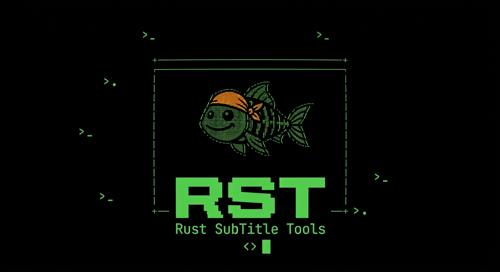

<h1 align="center">
  
</h1>

<p align="center">
  A Rust terminal application for extracting and translating video subtitles, simply and directly.
</p>

[Português](README.md) · [English](README.en.md) · [Español](README.es.md)

RST detects and extracts subtitle tracks from MKV/WebM and MP4/MOV files using built-in Rust parsers.

## Story

I originally created RST for my own use. My wife and I enjoy watching lesser-known survival shows. Since she does not speak English and Portuguese subtitles were hard to find, I needed a way to extract the English subtitles from episodes and translate them.

Before RST, I used `ffprobe` to find the subtitle track index, `ffmpeg` to extract it, and then split the file into chunks to translate them one by one with Google Translate, which limits the size of the text it accepts. The whole process took five to ten minutes.

RST makes this workflow much simpler: its interactive interface guides you through extraction and translation in just a few steps, without requiring you to know terminal commands.

I also added subtitle creation with Whisper. The idea came up when we wanted to watch a special episode of the same show that had no subtitles at all. To use this feature, install Whisper and FFmpeg; see the [requirements](#requirements).

I hope RST will be useful to other people too! 😄

## Downloads

| Platform      | Architecture              | Portable ZIP                                                                                                  | Installer                                                                                                       | Debian package                                                                           | GPG signature                                                                                     | Compressed package                                                                             |
| ------------- | ------------------------- | ------------------------------------------------------------------------------------------------------------- | --------------------------------------------------------------------------------------------------------------- | ---------------------------------------------------------------------------------------- | ------------------------------------------------------------------------------------------------- | --------------------------------------------------------------------------------------------- |
| Windows       | x64 (64-bit)              | [rst_windows_x64.zip](https://github.com/warubert/rst/releases/latest/download/rst_windows_x64.zip)           | [rst_windows_x64.msi](https://github.com/warubert/rst/releases/latest/download/rst_windows_x64.msi)             | —                                                                                        | —                                                                                                 | —                                                                                             |
| Windows       | x86 (32-bit)              | [rst_windows_x86.zip](https://github.com/warubert/rst/releases/latest/download/rst_windows_x86.zip)           | [rst_windows_x86.msi](https://github.com/warubert/rst/releases/latest/download/rst_windows_x86.msi)             | —                                                                                        | —                                                                                                 | —                                                                                             |
| macOS         | arm64 (Apple Silicon)     | [rst_macos_arm64.zip](https://github.com/warubert/rst/releases/latest/download/rst_macos_arm64.zip)           | [rst_macos_arm64.pkg](https://github.com/warubert/rst/releases/latest/download/rst_macos_arm64.pkg)             | —                                                                                        | —                                                                                                 | —                                                                                             |
| macOS         | x64 (Intel)               | [rst_macos_x64.zip](https://github.com/warubert/rst/releases/latest/download/rst_macos_x64.zip)               | [rst_macos_x64.pkg](https://github.com/warubert/rst/releases/latest/download/rst_macos_x64.pkg)                 | —                                                                                        | —                                                                                                 | —                                                                                             |
| Debian/Ubuntu | amd64                     | —                                                                                                             | —                                                                                                               | [rst_amd64.deb](https://github.com/warubert/rst/releases/latest/download/rst_amd64.deb)   | [rst_amd64.deb.asc](https://github.com/warubert/rst/releases/latest/download/rst_amd64.deb.asc)   | [rst_amd64.tar.gz](https://github.com/warubert/rst/releases/latest/download/rst_amd64.tar.gz) |
| Debian/Ubuntu | arm64                     | —                                                                                                             | —                                                                                                               | [rst_arm64.deb](https://github.com/warubert/rst/releases/latest/download/rst_arm64.deb)   | [rst_arm64.deb.asc](https://github.com/warubert/rst/releases/latest/download/rst_arm64.deb.asc)   | [rst_arm64.tar.gz](https://github.com/warubert/rst/releases/latest/download/rst_arm64.tar.gz) |
| Debian/Ubuntu | i386 (32-bit)             | —                                                                                                             | —                                                                                                               | [rst_i386.deb](https://github.com/warubert/rst/releases/latest/download/rst_i386.deb)     | [rst_i386.deb.asc](https://github.com/warubert/rst/releases/latest/download/rst_i386.deb.asc)     | [rst_i386.tar.gz](https://github.com/warubert/rst/releases/latest/download/rst_i386.tar.gz)   |

### Install from the APT repository

```bash
curl -fsSLo /tmp/rst-public.key https://warubert.github.io/rst/public.key
gpg --show-keys --with-fingerprint /tmp/rst-public.key
gpg --dearmor < /tmp/rst-public.key | sudo tee /usr/share/keyrings/rst-archive-keyring.gpg >/dev/null
echo "deb [signed-by=/usr/share/keyrings/rst-archive-keyring.gpg] https://warubert.github.io/rst stable main" | sudo tee /etc/apt/sources.list.d/rst.list
sudo apt-get update
sudo apt-get install rst
```

To install the 32-bit (`i386`) package on an amd64 system with multiarch support:

```bash
sudo dpkg --add-architecture i386
sudo apt-get update
sudo apt-get install rst:i386
```

For previous versions, see [all releases](https://github.com/warubert/rst/releases).

## Features

- Detects available subtitle tracks in a video file
- Saves the selected track as an `.srt` file
- Provides an interface in Portuguese, English, and Spanish
- Translates `.srt` files using Google Translate, splitting large subtitles across multiple asynchronous requests
- Extracts and translates a subtitle track from a video in one workflow
- Creates `.srt` subtitles from a video's audio with Whisper
- Creates subtitles with Whisper and translates them in one workflow

The language selected in **Options** is saved in the user's settings and takes precedence over the system language on future runs.

## Requirements

To create subtitles with Whisper, install [OpenAI Whisper](https://github.com/openai/whisper) and make sure the `whisper` and `ffmpeg` commands are available on your `PATH` (for example, `pip install -U openai-whisper` and `sudo apt install ffmpeg`; on Windows, `winget install Gyan.FFmpeg`). Reopen the terminal after installation so it picks up the updated `PATH`. This feature is unavailable if the `whisper` command cannot run; Whisper uses FFmpeg to read audio.

## Tests

Run the automated test suite:

```bash
cargo test
```

To check formatting, compilation, and lint:

```bash
cargo fmt --check
cargo check
cargo clippy -- -D warnings
```

## User settings

Settings are stored in the user's configuration directory:

- Linux: `~/.config/rst/` (or `$XDG_CONFIG_HOME/rst/`, if set)
- macOS: `~/Library/Application Support/rst/`
- Windows: `%APPDATA%\rst\`

The language is stored in the `language` file. The API key entered in **Options** is stored in `google_translate_api_key`, and the **Use API key** toggle is stored in `use_api_key`. The key is stored as plain text, but its input screen always displays `***`; on Unix, the file has `0600` permissions.

## Build

```bash
cargo build --release
```

## Usage

Run without arguments to open the menu:

```bash
rst
```

Use the arrow keys to navigate and Enter to select. All interface screens except the main menu open in a window over it. In the file browser, type to filter files and folders; Enter opens a folder or selects a file; Backspace clears the filter or returns to the previous folder; F2 lets you enter a path manually; Esc cancels. During extraction and translation, the interface displays percentage progress. Choose **Extract subtitle** to select a video, choose a track, and set the output `.srt` filename.

Choose **Extract and translate** to extract a video track and then translate it. The source language is read from the selected track's metadata, so the program only asks for the target language. The extracted SRT is kept alongside a second, translated file; you can cancel translation after extraction and keep the first file. If the metadata does not specify a language, automatic detection is used.

Choose **Create subtitles with Whisper** to select a video, choose the spoken language using autocomplete, and set the output `.srt` filename. By default, the suggested name keeps the video's base name; you can change the filename or provide a different path. The program displays the progress reported by Whisper.

Choose **Create subtitles with Whisper and translate** to generate an SRT in the spoken language and then translate it. The language selected in Whisper is used as the translation source; the original SRT is preserved even if translation is cancelled or fails.

Without arguments, the program opens the interactive menu. To run an action without opening the interface, use `--action` and provide its required parameters. For CLI extraction, specify the subtitle track's language code, such as `pt` or `en`; a regional variant such as `pt-BR` also matches `pt`.

```bash
cargo run -- --action extract --input "video.mkv" --subtitle-language pt --output "video.srt"
cargo run -- --action translate --input "video.srt" --source-language en --target-language pt --output "video-pt.srt"
cargo run -- --action extract-and-translate --input "video.mkv" --subtitle-language en --target-language pt --output "video.srt" --translated-output "video-pt.srt"
cargo run -- --action transcribe --input "video.mkv" --language en --output "video.srt"
cargo run -- --action transcribe-and-translate --input "video.mkv" --language en --target-language pt --output "video.srt" --translated-output "video-pt.srt"
```

Supported actions are `extract`, `translate`, `extract-and-translate`, `transcribe`, and `transcribe-and-translate`. In combined actions, `--output` is the original SRT and `--translated-output` is the translated SRT. Translation of an extracted track uses its metadata language; if missing, automatic detection is used. `--source-language auto` also enables automatic detection for the `translate` action. See the options with `cargo run -- --help`.

## Extraction

Common text subtitle tracks in MKV/WebM (`S_TEXT/UTF8`, ASS/SSA, and WebVTT) and `mov_text` tracks in MP4/MOV are supported.

If no output filename is provided, the program uses the video filename with the `.srt` extension.

## Translation

Choose **Translate subtitle** from the menu. The program asks, in order:

1. The `.srt` file, using the file browser or by entering its path with `T`.
2. The source language from a searchable list, with **Automatic** selected by default.
3. The target language from a searchable list of the 249 languages in Google's catalog (names are shown in the language selected in the program; search by name or code; default: the language configured in the program).
4. The translated output filename (default: `original_name-language.srt`, for example `AloneS13E13-pt.srt`).

Timestamps and positioning tags (such as `{\an8}`) are preserved. Subtitles are sent in batches of up to 100 texts or 4,000 characters, with up to 4 concurrent requests and retries on failure.

### API key (optional)

The program uses two translation services. In **Options**, **Use API key** controls which service is used. When enabled, the key saved in Options takes precedence over `GOOGLE_TRANSLATE_API_KEY`; if no key is available, the program uses the service that does not require a key. When disabled, the program always uses the no-key service.

| Situation                              | Service                                      | Quality |
| -------------------------------------- | -------------------------------------------- | ------- |
| Toggle on and key saved/env is set     | `translateHtml`, with a key                  | Higher  |
| Toggle off or no key                   | `translate_a/single` (`gtx`), without a key  | Lower   |

Translation works without a key, and the program notifies you when it uses the no-key service. In tests with the sample file, the no-key service produced the same structure (subtitles, timestamps, and tags), but only about 27% of subtitles had the same text as with the keyed service; in several cases, the keyed version sounded more natural.

The key can be entered in **Options** or provided through the `GOOGLE_TRANSLATE_API_KEY` environment variable (including in a `.env` file in the directory where the program runs). A key saved in Options takes precedence over the environment variable; turning off the toggle forces use of the no-key service.

1. Copy the example file and add your key:

   ```bash
   cp .env.example .env
   ```

   ```env
   GOOGLE_TRANSLATE_API_KEY=your_key_here
   ```

To get a key:

1. Open the [Google Cloud Console](https://console.cloud.google.com/) and create or select a project.
2. Under **APIs & Services**, enable the **Cloud Translation API**.
3. Under **APIs & Services > Credentials**, choose **Create credentials > API key**.
4. Restrict the key to the Cloud Translation API and copy it to `.env`.

Tests using the live service are ignored by default. The first uses the key from `.env`; the second does not require a key:

```bash
cargo test translates_the_sample_file_with_the_real_service -- --ignored
cargo test translates_the_sample_file_without_an_api_key -- --ignored
```
