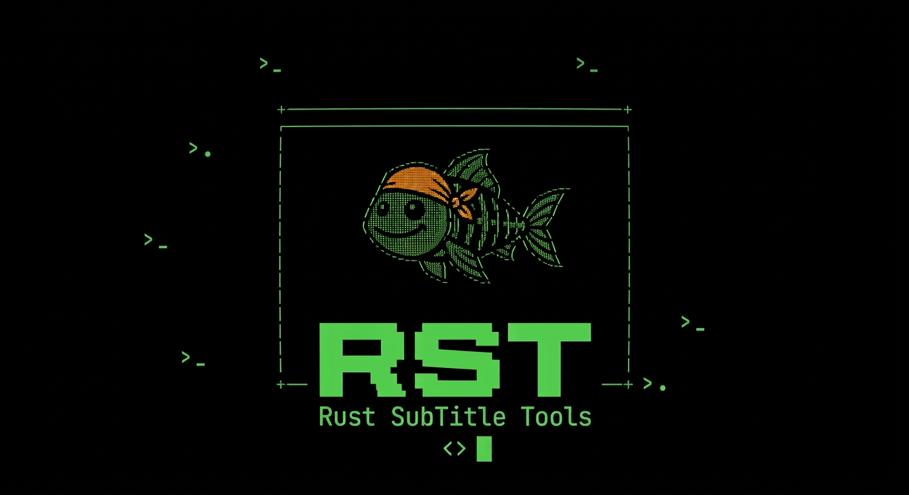

[Português](README.md) · [English](README.en.md) · [Español](README.es.md)

<h1 align="center">
  
</h1>

<p align="center">
  Aplicación de terminal escrita en Rust para extraer y traducir subtítulos de videos de forma sencilla y directa.
</p>

RST detecta y extrae pistas de subtítulos de archivos MKV/WebM y MP4/MOV mediante analizadores integrados en Rust.

## Historia

Al principio creé RST para uso propio. A mi esposa y a mí nos gusta ver series de supervivencia poco conocidas. Como ella no habla inglés y rara vez encontrábamos subtítulos en portugués, necesitaba extraer los subtítulos en inglés de los episodios y traducirlos.

Antes de RST, usaba `ffprobe` para averiguar el índice de la pista de subtítulos, `ffmpeg` para extraerla y luego dividía el archivo en fragmentos para traducirlos uno por uno con Google Traductor, que limita el tamaño de los textos. El proceso tardaba entre cinco y diez minutos.

RST simplifica mucho este flujo: su interfaz interactiva guía la extracción y la traducción en pocos pasos, sin necesidad de conocer los comandos de la terminal.

También añadí la creación de subtítulos con Whisper. La idea surgió cuando quisimos ver un episodio especial de la misma serie que no tenía subtítulos. Para usar esta función, instala Whisper y FFmpeg; consulta los [requisitos](#requisitos).

¡Espero que RST también sea útil para otras personas! 😄

## Descargas

| Plataforma    | Arquitectura          | ZIP portátil                                                                                        | Instalador                                                                                          | Paquete Debian                                                                          | Firma GPG                                                                                       | Paquete comprimido                                                                            |
| ------------- | --------------------- | --------------------------------------------------------------------------------------------------- | --------------------------------------------------------------------------------------------------- | --------------------------------------------------------------------------------------- | ----------------------------------------------------------------------------------------------- | --------------------------------------------------------------------------------------------- |
| Windows       | x64 (64 bits)         | [rst_windows_x64.zip](https://github.com/warubert/rst/releases/latest/download/rst_windows_x64.zip) | [rst_windows_x64.msi](https://github.com/warubert/rst/releases/latest/download/rst_windows_x64.msi) | —                                                                                       | —                                                                                               | —                                                                                             |
| Windows       | x86 (32 bits)         | [rst_windows_x86.zip](https://github.com/warubert/rst/releases/latest/download/rst_windows_x86.zip) | [rst_windows_x86.msi](https://github.com/warubert/rst/releases/latest/download/rst_windows_x86.msi) | —                                                                                       | —                                                                                               | —                                                                                             |
| macOS         | arm64 (Apple Silicon) | [rst_macos_arm64.zip](https://github.com/warubert/rst/releases/latest/download/rst_macos_arm64.zip) | [rst_macos_arm64.pkg](https://github.com/warubert/rst/releases/latest/download/rst_macos_arm64.pkg) | —                                                                                       | —                                                                                               | —                                                                                             |
| macOS         | x64 (Intel)           | [rst_macos_x64.zip](https://github.com/warubert/rst/releases/latest/download/rst_macos_x64.zip)     | [rst_macos_x64.pkg](https://github.com/warubert/rst/releases/latest/download/rst_macos_x64.pkg)     | —                                                                                       | —                                                                                               | —                                                                                             |
| Debian/Ubuntu | amd64                 | —                                                                                                   | —                                                                                                   | [rst_amd64.deb](https://github.com/warubert/rst/releases/latest/download/rst_amd64.deb) | [rst_amd64.deb.asc](https://github.com/warubert/rst/releases/latest/download/rst_amd64.deb.asc) | [rst_amd64.tar.gz](https://github.com/warubert/rst/releases/latest/download/rst_amd64.tar.gz) |
| Debian/Ubuntu | arm64                 | —                                                                                                   | —                                                                                                   | [rst_arm64.deb](https://github.com/warubert/rst/releases/latest/download/rst_arm64.deb) | [rst_arm64.deb.asc](https://github.com/warubert/rst/releases/latest/download/rst_arm64.deb.asc) | [rst_arm64.tar.gz](https://github.com/warubert/rst/releases/latest/download/rst_arm64.tar.gz) |
| Debian/Ubuntu | i386 (32 bits)        | —                                                                                                   | —                                                                                                   | [rst_i386.deb](https://github.com/warubert/rst/releases/latest/download/rst_i386.deb)   | [rst_i386.deb.asc](https://github.com/warubert/rst/releases/latest/download/rst_i386.deb.asc)   | [rst_i386.tar.gz](https://github.com/warubert/rst/releases/latest/download/rst_i386.tar.gz)   |

### Instalar desde el repositorio APT

```bash
curl -fsSLo /tmp/rst-public.key https://warubert.github.io/rst/public.key
gpg --show-keys --with-fingerprint /tmp/rst-public.key
gpg --dearmor < /tmp/rst-public.key | sudo tee /usr/share/keyrings/rst-archive-keyring.gpg >/dev/null
echo "deb [signed-by=/usr/share/keyrings/rst-archive-keyring.gpg] https://warubert.github.io/rst stable main" | sudo tee /etc/apt/sources.list.d/rst.list
sudo apt-get update
sudo apt-get install rst
```

Para instalar el paquete de 32 bits (`i386`) en un sistema amd64 con soporte multiarch:

```bash
sudo dpkg --add-architecture i386
sudo apt-get update
sudo apt-get install rst:i386
```

Para descargar versiones anteriores, consulta [todas las versiones](https://github.com/warubert/rst/releases).

## Funcionalidades

- Detecta las pistas de subtítulos disponibles en un archivo de video
- Guarda la pista seleccionada en formato `.srt`
- Ofrece una interfaz en portugués, inglés y español
- Traduce archivos `.srt` mediante Google Traductor, dividiendo subtítulos largos en varias solicitudes asíncronas
- Extrae y traduce una pista de subtítulos del video en un solo flujo
- Crea subtítulos `.srt` a partir del audio de un video con Whisper
- Crea subtítulos con Whisper y traduce el resultado en un solo flujo

El idioma elegido en **Opciones** se guarda en la configuración del usuario y tiene prioridad sobre el idioma del sistema en las siguientes ejecuciones.

## Requisitos

Para crear subtítulos con Whisper, instala [OpenAI Whisper](https://github.com/openai/whisper) y asegúrate de que los comandos `whisper` y `ffmpeg` estén disponibles en el `PATH` (por ejemplo, `pip install -U openai-whisper` y `sudo apt install ffmpeg`; en Windows, `winget install Gyan.FFmpeg`). Después de instalar, vuelve a abrir la terminal para que recoja el `PATH` actualizado. Esta función no estará disponible si no se puede ejecutar el comando `whisper`; Whisper usa FFmpeg para leer el audio.

## Uso

Inicia el programa sin argumentos para abrir el menú:

```bash
rst
```

Usa las flechas para navegar y Enter para seleccionar. Todas las pantallas de la interfaz, excepto el menú principal, se abren en una ventana superpuesta. En el explorador, escribe para filtrar archivos y carpetas; Enter abre una carpeta o selecciona un archivo; Backspace borra el filtro o vuelve a la carpeta anterior; F2 permite escribir una ruta manualmente; Esc cancela. Durante la extracción y la traducción, la interfaz muestra el porcentaje de progreso. Elige **Extraer subtítulo** para seleccionar el video, elegir una pista y definir el nombre del archivo `.srt` de salida.

Elige **Extraer y traducir** para extraer una pista del video y traducirla a continuación. El idioma de origen se obtiene de los metadatos de la pista seleccionada, por lo que el programa solo pregunta el idioma de destino. El SRT extraído se conserva junto a un segundo archivo traducido; puedes cancelar la traducción después de la extracción y conservar el primer archivo. Si los metadatos no indican el idioma, se usa la detección automática.

Elige **Crear subtítulos con Whisper** para seleccionar el video, elegir el idioma hablado mediante el autocompletado y definir el nombre del `.srt` de salida. De forma predeterminada, el nombre sugerido conserva el nombre base del video; puedes cambiarlo o indicar otra ruta. El programa muestra el porcentaje de progreso informado por Whisper.

Elige **Crear subtítulos con Whisper y traducir** para generar un SRT en el idioma hablado y traducirlo a continuación. El idioma seleccionado en Whisper se usa como origen de la traducción; el SRT original se conserva aunque la traducción se cancele o falle.

Sin argumentos, el programa abre el menú interactivo. Para ejecutar una acción sin abrir la interfaz, usa `--action` e indica los parámetros requeridos. Para extraer desde el CLI, indica el código del idioma de la pista, como `pt` o `en`; una variante regional como `pt-BR` también coincide con `pt`.

```bash
rst --action extract --input "video.mkv" --subtitle-language pt --output "video.srt"
rst --action translate --input "video.srt" --source-language en --target-language pt --output "video-pt.srt"
rst --action extract-and-translate --input "video.mkv" --subtitle-language en --target-language pt --output "video.srt" --translated-output "video-pt.srt"
rst --action transcribe --input "video.mkv" --language en --output "video.srt"
rst --action transcribe-and-translate --input "video.mkv" --language en --target-language pt --output "video.srt" --translated-output "video-pt.srt"
```

Las acciones disponibles son `extract`, `translate`, `extract-and-translate`, `transcribe` y `transcribe-and-translate`. En las acciones combinadas, `--output` corresponde al SRT original y `--translated-output` al SRT traducido. La traducción de una pista extraída usa el idioma de sus metadatos; si no está indicado, se usa la detección automática. `--source-language auto` también activa la detección automática en la acción `translate`. Consulta las opciones con `rst --help`.

## Extracción

Se admiten pistas de subtítulos de texto comunes en MKV/WebM (`S_TEXT/UTF8`, ASS/SSA y WebVTT), así como pistas `mov_text` en MP4/MOV.

Si no se indica un nombre de salida, el programa usa el nombre del archivo de video con la extensión `.srt`.

## Traducción

Elige **Traducir subtítulo** en el menú. El programa pregunta, en este orden:

1. El archivo `.srt`, mediante el explorador o escribiendo la ruta con `T`.
2. El idioma de origen en una lista con búsqueda, con **Automático** seleccionado de forma predeterminada.
3. El idioma de destino en una lista con búsqueda que contiene los 249 idiomas del catálogo de Google (los nombres se muestran en el idioma seleccionado en el programa; puedes buscar por nombre o código; valor predeterminado: el idioma configurado en el programa).
4. El nombre del archivo traducido (valor predeterminado: `nombre_original-idioma.srt`, por ejemplo, `AloneS13E13-pt.srt`).

Se conservan los tiempos y las etiquetas de posición (como `{\an8}`). Los subtítulos se envían en lotes de hasta 100 textos o 4000 caracteres, con hasta 4 solicitudes simultáneas y nuevos intentos en caso de error.

## Pruebas

Ejecuta la suite automatizada:

```bash
cargo test
```

Para comprobar el formato, la compilación y el lint:

```bash
cargo fmt --check
cargo check
cargo clippy -- -D warnings
```

## Configuración del usuario

La configuración se guarda en el directorio de configuración del usuario:

- Linux: `~/.config/rst/` (o `$XDG_CONFIG_HOME/rst/`, si está definido)
- macOS: `~/Library/Application Support/rst/`
- Windows: `%APPDATA%\rst\`

El idioma se guarda en el archivo `language`. La clave introducida en **Opciones** se guarda en `google_translate_api_key`, y el interruptor **Usar clave de API** se guarda en `use_api_key`. La clave se almacena como texto sin cifrar, pero la pantalla de entrada siempre muestra `***`; en Unix, el archivo tiene permisos `0600`.

## Compilar

```bash
cargo build --release
```

### Clave de API (opcional)

El programa usa dos servicios de traducción. En **Opciones**, **Usar clave de API** controla cuál se utiliza. Cuando está activado, la clave guardada en Opciones tiene prioridad sobre `GOOGLE_TRANSLATE_API_KEY`; si no hay ninguna clave, el programa usa el servicio que no requiere una. Cuando está desactivado, siempre se usa el servicio sin clave.

| Situación                                          | Servicio                                | Calidad |
| -------------------------------------------------- | --------------------------------------- | ------- |
| Interruptor activado y clave guardada/env definida | `translateHtml`, con clave              | Mayor   |
| Interruptor desactivado o sin clave                | `translate_a/single` (`gtx`), sin clave | Menor   |

La traducción funciona sin clave, y el programa avisa cuando usa el servicio sin clave. En las pruebas con el archivo de ejemplo, el servicio sin clave produjo la misma estructura (subtítulos, tiempos y etiquetas), pero solo alrededor del 27 % de los subtítulos conservaron el mismo texto que con el servicio con clave; en varios casos, la versión con clave sonó más natural.

La clave se puede introducir en **Opciones** o proporcionar mediante la variable de entorno `GOOGLE_TRANSLATE_API_KEY` (también en un archivo `.env` en el directorio desde el que se ejecuta el programa). La clave guardada en Opciones tiene prioridad sobre la variable de entorno; al desactivar el interruptor se fuerza el uso del servicio sin clave.

1. Copia el archivo de ejemplo y añade la clave:

   ```bash
   cp .env.example .env
   ```

   ```env
   GOOGLE_TRANSLATE_API_KEY=tu_clave_aqui
   ```

Para obtener una clave:

1. Accede a [Google Cloud Console](https://console.cloud.google.com/) y crea o selecciona un proyecto.
2. En **APIs y servicios**, activa la **Cloud Translation API**.
3. En **APIs y servicios > Credenciales**, elige **Crear credenciales > Clave de API**.
4. Restringe la clave a Cloud Translation API y cópiala en `.env`.

Las pruebas con el servicio real se omiten de forma predeterminada. La primera usa la clave de `.env`; la segunda no requiere una clave:

```bash
cargo test translates_the_sample_file_with_the_real_service -- --ignored
cargo test translates_the_sample_file_without_an_api_key -- --ignored
```
