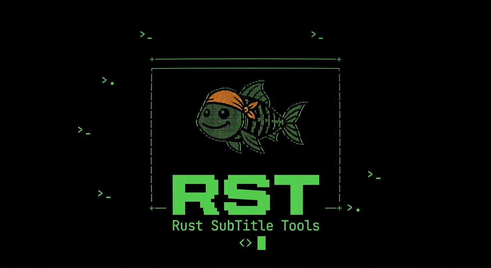

<h1 align="center">
  
</h1>

<p align="center">
  Ferramenta de terminal escrita em Rust para extrair e traduzir legendas de vídeos.
</p>

O RST detecta e extrai faixas de legenda de arquivos MKV/WebM e MP4/MOV com parsers Rust integrados.

## Funcionalidades

- Detecta as faixas de legenda disponíveis em um arquivo de vídeo
- Permite selecionar a faixa a extrair
- Salva a legenda selecionada em formato `.srt`
- Oferece uma interface interativa de terminal com Ratatui
- Permite navegar por pastas e selecionar arquivos de vídeo e `.srt` na interface
- Disponibiliza a interface em português, inglês e espanhol
- Detecta o idioma do sistema na primeira execução e permite alterá-lo em **Opções**
- Usa inglês quando o idioma do sistema não é português, inglês ou espanhol
- Traduz arquivos `.srt` pelo serviço de tradução do Google, dividindo legendas grandes em várias requisições assíncronas
- Extrai e traduz uma faixa de legenda do vídeo em um único fluxo
- Cria legendas `.srt` com Whisper a partir do áudio do vídeo
- Cria legendas com Whisper e traduz o resultado em um único fluxo

O idioma escolhido em **Opções** é salvo nas configurações do usuário e tem prioridade sobre o idioma do sistema nas próximas execuções.

## Requisitos

Também é necessário ter o Rust e o Cargo instalados para compilar o projeto.

Para criar legendas com Whisper, instale o [OpenAI Whisper](https://github.com/openai/whisper) e deixe os comandos `whisper` e `ffmpeg` disponíveis no `PATH` (por exemplo, `pip install -U openai-whisper` e `sudo apt install ffmpeg`). Essa opção fica indisponível se o comando Whisper não puder ser executado; o FFmpeg é usado pelo Whisper para ler o áudio.

## Testes

Execute a suíte automatizada com:

```bash
cargo test
```

Os testes cobrem o parsing e a extração de faixas de legenda, a conversão para SRT, a transcrição, o progresso do Whisper, o fluxo de entrada com e sem argumento, as ações do menu, a geração do nome `.srt`, a seleção e persistência do idioma, a renderização das telas Ratatui e o fluxo combinado de extração e tradução com dependências simuladas.

Para verificar formatação, compilação e lint:

```bash
cargo fmt --check
cargo check
cargo clippy -- -D warnings
```

## Configurações do usuário

As configurações são gravadas dentro do diretório de configuração do usuário:

- Linux: `~/.config/rst/` (ou `$XDG_CONFIG_HOME/rst/`, se definido)
- macOS: `~/Library/Application Support/rst/`
- Windows: `%APPDATA%\rst\`

O idioma fica no arquivo `language`; a chave digitada em **Opções** fica em `google_translate_api_key`; e o toggle **Usar chave de API** fica em `use_api_key`. A chave é armazenada em texto simples, mas sua tela de entrada sempre mostra `***`; no Unix, o arquivo tem permissão `0600`.

## Compilar

```bash
cargo build --release
```

**Downloads diretos** (disponíveis após a próxima release):

| Plataforma    | Arquitetura           | ZIP portátil                                                                                        | Instalador                                                                                          | Pacote Debian                                                                           | Assinatura GPG                                                                                  | Pacote compactado                                                                             |
| ------------- | --------------------- | --------------------------------------------------------------------------------------------------- | --------------------------------------------------------------------------------------------------- | --------------------------------------------------------------------------------------- | ----------------------------------------------------------------------------------------------- | --------------------------------------------------------------------------------------------- |
| Windows       | x64 (64 bits)         | [rst_windows_x64.zip](https://github.com/warubert/rst/releases/latest/download/rst_windows_x64.zip) | [rst_windows_x64.msi](https://github.com/warubert/rst/releases/latest/download/rst_windows_x64.msi) | —                                                                                       | —                                                                                               | —                                                                                             |
| Windows       | x86 (32 bits)         | [rst_windows_x86.zip](https://github.com/warubert/rst/releases/latest/download/rst_windows_x86.zip) | [rst_windows_x86.msi](https://github.com/warubert/rst/releases/latest/download/rst_windows_x86.msi) | —                                                                                       | —                                                                                               | —                                                                                             |
| macOS         | arm64 (Apple Silicon) | [rst_macos_arm64.zip](https://github.com/warubert/rst/releases/latest/download/rst_macos_arm64.zip) | [rst_macos_arm64.pkg](https://github.com/warubert/rst/releases/latest/download/rst_macos_arm64.pkg) | —                                                                                       | —                                                                                               | —                                                                                             |
| macOS         | x64 (Intel)           | [rst_macos_x64.zip](https://github.com/warubert/rst/releases/latest/download/rst_macos_x64.zip)     | [rst_macos_x64.pkg](https://github.com/warubert/rst/releases/latest/download/rst_macos_x64.pkg)     | —                                                                                       | —                                                                                               | —                                                                                             |
| Debian/Ubuntu | amd64                 | —                                                                                                   | —                                                                                                   | [rst_amd64.deb](https://github.com/warubert/rst/releases/latest/download/rst_amd64.deb) | [rst_amd64.deb.asc](https://github.com/warubert/rst/releases/latest/download/rst_amd64.deb.asc) | [rst_amd64.tar.gz](https://github.com/warubert/rst/releases/latest/download/rst_amd64.tar.gz) |
| Debian/Ubuntu | arm64                 | —                                                                                                   | —                                                                                                   | [rst_arm64.deb](https://github.com/warubert/rst/releases/latest/download/rst_arm64.deb) | [rst_arm64.deb.asc](https://github.com/warubert/rst/releases/latest/download/rst_arm64.deb.asc) | [rst_arm64.tar.gz](https://github.com/warubert/rst/releases/latest/download/rst_arm64.tar.gz) |
| Debian/Ubuntu | i386 (32 bits)        | —                                                                                                   | —                                                                                                   | [rst_i386.deb](https://github.com/warubert/rst/releases/latest/download/rst_i386.deb)   | [rst_i386.deb.asc](https://github.com/warubert/rst/releases/latest/download/rst_i386.deb.asc)   | [rst_i386.tar.gz](https://github.com/warubert/rst/releases/latest/download/rst_i386.tar.gz)   |

O ZIP contém o executável, este README e a licença; basta extrair e executar `rst.exe`. O MSI instala o RST em `Program Files`, adiciona a pasta ao `PATH` do sistema, e cria atalhos no menu Iniciar e na área de trabalho; requer privilégios de administrador.

No macOS, o ZIP contém o executável `rst` e o `.pkg` o instala em `/usr/local/bin` e instala também o `RST.app` em `/Applications`, que abre o RST no Terminal. Os pacotes macOS são publicados sem assinatura; o Gatekeeper pode exibir um aviso.

Os links apontam para os arquivos da release mais recente. Para baixar versões anteriores, consulte [todas as releases](https://github.com/warubert/rst/releases).

O workflow do GitHub Actions executa formatação, Clippy e testes em amd64 e arm64, compila os testes i386 sem executá-los no runner de 64 bits e valida builds Windows x64/x86 e macOS Intel/Apple Silicon. Ao enviar uma tag `vX.Y.Z` igual à versão do `Cargo.toml`, ele cria pacotes `.deb` para amd64, arm64 e i386, ZIPs e instaladores MSI para Windows x64/x86, e ZIPs e instaladores `.pkg` para macOS Intel/arm64. Os arquivos são publicados em uma GitHub Release e os índices do repositório APT assinado são atualizados no GitHub Pages. O pacote i386 é de 32 bits; em um Ubuntu amd64, é necessário habilitar a arquitetura i386 no APT para instalá-lo.

adicionar o repositório:

```bash
curl -fsSLo /tmp/rst-public.key https://warubert.github.io/rst/public.key
gpg --show-keys --with-fingerprint /tmp/rst-public.key
gpg --dearmor < /tmp/rst-public.key | sudo tee /usr/share/keyrings/rst-archive-keyring.gpg >/dev/null
echo "deb [signed-by=/usr/share/keyrings/rst-archive-keyring.gpg] https://warubert.github.io/rst stable main" | sudo tee /etc/apt/sources.list.d/rst.list
sudo apt-get update
sudo apt-get install rst
```

Para instalar especificamente o pacote de 32 bits (`i386`) em um sistema amd64 com suporte multiarch:

```bash
sudo dpkg --add-architecture i386
sudo apt-get update
sudo apt-get install rst:i386
```

Para a versão `1.0.0`, crie e envie a tag:

```bash
git tag v1.0.0
git push origin v1.0.0
```

## Uso

Inicie sem argumentos para abrir o menu:

```bash
cargo run
```

Use as setas para navegar e Enter para selecionar. Todas as telas da interface, exceto o menu principal, abrem em uma janela sobre ele. No explorador, digite para filtrar arquivos e pastas; Enter abre uma pasta ou seleciona um arquivo; Backspace apaga o filtro ou volta à pasta anterior; F2 permite digitar o caminho manualmente; Esc cancela. Durante a extração e a tradução, a interface mostra o progresso percentual. Escolha **Extrair legenda** para selecionar o vídeo, escolher uma faixa e definir o nome do arquivo `.srt` de saída.

Escolha **Extrair e traduzir** para extrair uma faixa do vídeo e traduzi-la em seguida. O idioma original é obtido dos metadados da faixa selecionada, então o programa pergunta apenas o idioma de destino. O SRT extraído é mantido junto com um segundo arquivo traduzido; é possível cancelar a tradução após a extração e manter o primeiro arquivo. Se os metadados não informarem o idioma, a detecção automática é usada.

Escolha **Criar legendas com Whisper** para selecionar o vídeo, escolher o idioma falado no autocomplete e definir o nome do `.srt` de saída. O nome sugerido por padrão mantém o nome-base do vídeo; o arquivo pode ser alterado ou receber outro caminho. O programa mostra o percentual informado pelo Whisper.

Escolha **Criar legendas com Whisper e traduzir** para gerar o SRT no idioma falado e traduzi-lo em seguida. O idioma selecionado no Whisper é usado como origem da tradução; o SRT original é preservado mesmo que a tradução seja cancelada ou falhe.

Sem argumentos, o programa abre o menu interativo. Para executar uma ação sem abrir a interface, use `--action` e informe os parâmetros exigidos por ela. Para extração pelo CLI, indique o código do idioma da faixa, como `pt` ou `en`; uma variante regional como `pt-BR` também corresponde a `pt`.

```bash
cargo run -- --action extract --input "video.mkv" --subtitle-language pt --output "video.srt"
cargo run -- --action translate --input "video.srt" --source-language en --target-language pt --output "video-pt.srt"
cargo run -- --action extract-and-translate --input "video.mkv" --subtitle-language en --target-language pt --output "video.srt" --translated-output "video-pt.srt"
cargo run -- --action transcribe --input "video.mkv" --language en --output "video.srt"
cargo run -- --action transcribe-and-translate --input "video.mkv" --language en --target-language pt --output "video.srt" --translated-output "video-pt.srt"
```

As ações aceitas são `extract`, `translate`, `extract-and-translate`, `transcribe` e `transcribe-and-translate`. Em ações combinadas, `--output` é o SRT original e `--translated-output` é o SRT traduzido. A tradução de uma faixa extraída usa o idioma dos metadados; quando ausente, usa detecção automática. `--source-language auto` também habilita detecção automática na ação `translate`. Consulte as opções com `cargo run -- --help`.

## Extração

São aceitas faixas textuais comuns em MKV/WebM (`S_TEXT/UTF8`, ASS/SSA e WebVTT) e faixas `mov_text` em MP4/MOV.

Se o nome de saída não for informado, o programa usa o nome do arquivo de vídeo com a extensão `.srt`.

## Tradução

Escolha **Traduzir legenda** no menu. O programa pergunta, em ordem:

1. o arquivo `.srt`, pelo explorador de arquivos ou digitando o caminho com `T`;
2. o idioma original em uma lista pesquisável, com **Automático** selecionado por padrão;
3. o idioma de destino, em uma lista pesquisável com os 249 idiomas do catálogo Google (nomes no idioma selecionado no programa; filtre por nome ou código; padrão: o idioma configurado no programa);
4. o nome do arquivo traduzido (padrão: `nome_original-idioma.srt`, por exemplo `AloneS13E13-pt.srt`).

Os tempos e as tags de posição (como `{\an8}`) são preservados. As legendas são enviadas em lotes de até 100 textos ou 4000 caracteres, com até 4 requisições simultâneas e novas tentativas em caso de falha.

### Chave de API (opcional)

O programa usa dois serviços de tradução. Em **Opções**, **Usar chave de API** controla qual será usado. Quando ativado, a chave salva nas opções tem prioridade sobre `GOOGLE_TRANSLATE_API_KEY`; se não houver chave, o programa usa o serviço sem chave. Quando desativado, o programa sempre usa o serviço sem chave.

| Situação                                 | Serviço                                 | Qualidade |
| ---------------------------------------- | --------------------------------------- | --------- |
| Toggle ligado e chave salva/env definida | `translateHtml`, com chave              | maior     |
| Toggle desligado ou nenhuma chave        | `translate_a/single` (`gtx`), sem chave | menor     |

Sem a chave a tradução funciona, e o programa avisa que está usando o serviço sem chave. Nos testes com o arquivo de exemplo, o resultado do serviço sem chave teve a mesma estrutura (legendas, tempos e tags), mas só cerca de 27% das legendas ficaram com o mesmo texto do serviço com chave; em vários casos a versão com chave soou mais natural.

Ela pode ser digitada em **Opções** ou fornecida pela variável de ambiente `GOOGLE_TRANSLATE_API_KEY` (inclusive por um arquivo `.env` na pasta onde o programa é executado). A chave salva nas opções tem prioridade sobre a variável de ambiente; desligar o toggle força o serviço sem chave.

1. Copie o arquivo de exemplo e preencha a chave:

   ```bash
   cp .env.example .env
   ```

   ```env
   GOOGLE_TRANSLATE_API_KEY=sua_chave_aqui
   ```

Para obter uma chave:

1. Acesse o [Google Cloud Console](https://console.cloud.google.com/) e crie ou selecione um projeto.
2. Em **APIs e serviços**, ative a **Cloud Translation API**.
3. Em **APIs e serviços > Credenciais**, escolha **Criar credenciais > Chave de API**.
4. Restrinja a chave à Cloud Translation API e copie o valor para o `.env`.

Os testes com o serviço real são ignorados por padrão. O primeiro usa a chave do `.env`; o segundo não precisa de chave:

```bash
cargo test translates_the_sample_file_with_the_real_service -- --ignored
cargo test translates_the_sample_file_without_an_api_key -- --ignored
```

### Em desenvolvimento

- melhorar readme e traduzir para en e es
- ajustar whisper no windows/mac(?)
- ajustar seleçao de pasta do instaladdor windows/mac(?)
